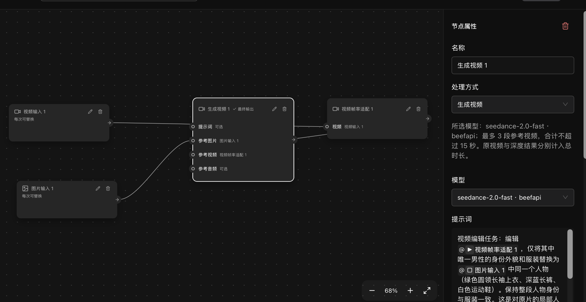
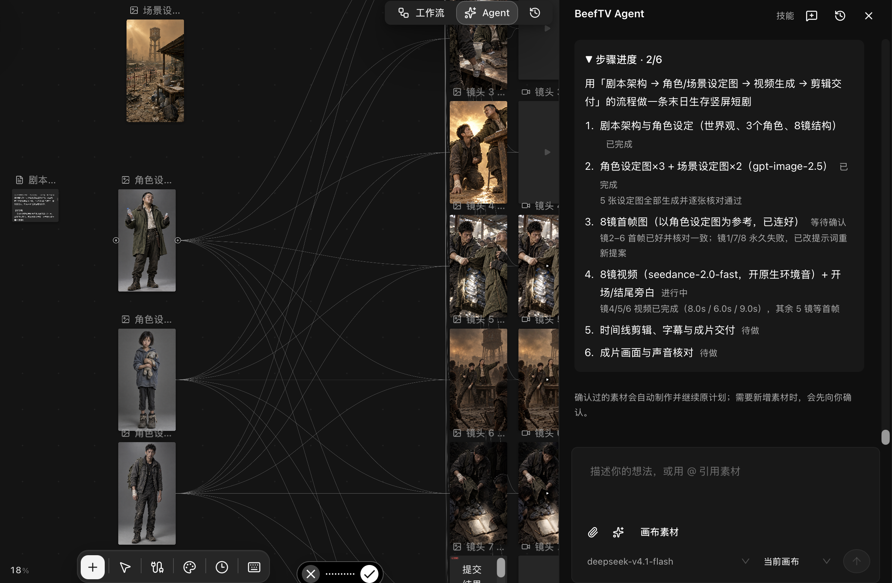
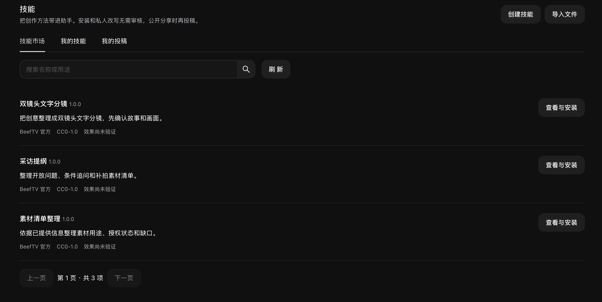

# MindVerseTV

> MindVerseTV is a modified version of BeefTV (glanderness/BeefTV, v2.2.5), not an official release and not endorsed by the upstream authors; it remains under the BeefTV Source Available License 1.0 and the historical MIT terms. Commercial resale, white-labelling, paid deployment, and hosting require the original author's written authorization.

<strong>High-performance · Lightweight · AI Native</strong>

  An AI-native workspace for video creation. 
  Connect ideas, models, and media on one freeform canvas.

  Create with MindVerseTV Agent, extend your methods with Skills, and reuse your process with Workflows. 
  From storyboards and media to finished videos, keep your work editable and ready to build on.

  
  
  
  
  

  <a href="README.md">简体中文</a> ·
  <a href="#recent-updates">Recent updates</a> ·
  <a href="#product-demo">Product demo</a> ·
  <a href="#workflows">Workflows</a> ·
  <a href="#mindversetv-agent">Agent</a> ·
  <a href="#skills">Skills</a> ·
  <a href="docs/content/docs/overview/features.mdx">Feature list</a> ·
  <a href="QUICKSTART.md">Get started</a> ·
  <a href="CONTRIBUTING.md">Contributing</a>

## Recent updates

- **[v2.3.6](https://github.com/canbaobaox/mindversetv/releases/tag/v2.3.6)** — Local AI subtitle/watermark removal (open-source VSR, auto-detects and inpaints subtitles and watermarks; first use downloads a ~1.5GB component), and a self-built signed manifest for depth capture (Windows components now download and verify from our own Release, CPU tier).
- **[v2.3.5](https://github.com/canbaobaox/mindversetv/releases/tag/v2.3.5)** — Fix 梦由心生 image generation still failing (resolution now only sends the site-accepted auto / 1K / 2K / 4K), show "价格待确认" instead of a blank price in the generation panel, tighten the AI upscale gate, and make depth capture failures show a persistent dialog instead of failing silently.
- **[v2.3.4](https://github.com/canbaobaox/mindversetv/releases/tag/v2.3.4)** — Fix 梦由心生 image generation failures (result URLs and polling now follow the site's media protocol), add select-all to model selection, and show each model's price.
- **[v2.3.3](https://github.com/canbaobaox/mindversetv/releases/tag/v2.3.3)** — Remove the Infistar, LL2, and Ysdui interface plugins, add the 梦由心生AI plugin, migrate the built-in channel to 梦由心生, and link account balance to 梦由心生.
- **[v2.3.2](https://github.com/canbaobaox/mindversetv/releases/tag/v2.3.2)** — Fix the Windows desktop issue where the built-in assistant could not read or modify the canvas across keep-alive turns on local named pipes.
- **[v2.3.1](https://github.com/canbaobaox/mindversetv/releases/tag/v2.3.1)** — Restore one-click channel setup compatibility for third-party desktop plugins, add the single-character replacement workflow, direct and batch storyboard asset binding, video-to-audio extraction, MCP call history, and prompt preset preferences, and ship storage migration rollback, domestic depth-runtime mirrors, and bundled macOS FFmpeg/ffprobe tools with corresponding open-source notices.
- **[v2.3.0](https://github.com/canbaobaox/mindversetv/releases/tag/v2.3.0)** — Move four community plugins to on-demand marketplace installation and update ComfyUI and AutoDL workflow support, add stacked image generation history with side-by-side comparison and details, add video smart erase and fixed reference slot ordering, refine failure source navigation and retry confirmation, and improve desktop startup resilience and multi-video canvas zoom smoothness.
- **[v2.2.5](https://github.com/canbaobaox/mindversetv/releases/tag/v2.2.5)** — Fix canvas uploads reverting to uploading overlays and replaced nodes being overwritten by stale tasks, fix desktop resource thumbnails, standalone storyboard generation, and batch download numbering, upgrade native video frame extraction and audio separation, and lift assistant skill size and count limits with paged line-by-line long-document reading.
- **[v2.2.4](https://github.com/canbaobaox/mindversetv/releases/tag/v2.2.4)** — Fix Eagle library previews and downloads on desktop, support prefixless custom model URLs and editing/deleting manual models, and fix prompt backspace editing, asset library pagination counts, and local video previews in generation history.
- **[v2.2.3](https://github.com/canbaobaox/mindversetv/releases/tag/v2.2.3)** — Add Seedream 5.5 image generation and fine-grained layer splitting, improve automatic first/last frame assignment and reference checks, fix upscale and subtitle-removal retry states and diagnostics, and add Yinsheng Yunshu Yisuan branding.
- **[v2.2.2](https://github.com/canbaobaox/mindversetv/releases/tag/v2.2.2)** — Add live balances and online top-ups, refine generation cost estimates, and upgrade DeepSeek Harness collaboration and canvas video processing.
- **[v2.2.1](https://github.com/canbaobaox/mindversetv/releases/tag/v2.2.1)** — Add the Yinsheng Yunshu Yisuan provider plugin, redesign plugin and account settings, and improve canvas previews, generation errors, and retries.

[All releases and detailed notes](https://github.com/canbaobaox/mindversetv/releases)

## Special thanks

BeefTV's former partners and sponsors (including ll2.cn, Yinsheng Yunshu Yisuan, Tencent Cloud, BytePlus, PCCOOLER, and Infistar) supported the upstream project; they are thanked here for the record only, without prices or promotional links. MindVerseTV does not integrate these commercial channels and provides no official compute; configure model channels with your own Base URL and Key.
## Product demo

  <video src="https://github.com/user-attachments/assets/da4081e0-26bc-424e-b20c-124f92ce6538" controls preload="metadata" playsinline></video>

## Workflows

**Save the steps that work for your next creation.**

Connect media, local processing, and AI generation in an editable workflow. The **single-character replacement workflow** takes a motion video and a character reference image, adapts the video frame rate, then passes both references to Seedance 2.0 Fast.

<table>
  <tr><th width="50%">Source video</th><th width="50%">Finished character replacement</th></tr>
  <tr>
    <td><video src="https://github.com/user-attachments/assets/1d8e5c42-d6be-40f5-be55-504b7381bf90" controls preload="metadata" playsinline></video></td>
    <td><video src="https://github.com/user-attachments/assets/cadf1e3b-e1fa-4a45-83a0-c8cdacc4d1b1" controls preload="metadata" playsinline></video></td>
  </tr>
</table>

[Production record](docs/content/docs/overview/examples.mdx#工作流单人物替换) (Chinese)

- **Connect processing and generation:** Adapt frame rate locally; use the video and character image as separate generation references.
- **Keep the configuration editable:** Adjust nodes, connections, models, prompts, and output settings, then save a template revision.
- **Reuse the structure with new inputs:** Bind a different motion video or character image; adapt constraints and parameters to the new shots.

Template revisions 13 and 14 have successful runs in the local 2.0.1 app. The finished example also includes shot-level corrections, stitching, and restoration of the original audio. Those steps are not all encapsulated in the template; this does not demonstrate one-click completion for arbitrary media or frame-perfect preservation. Model generation is billed by your chosen provider.

## MindVerseTV Agent

**Turn a conversation into an editable creative project.**

> “Help me make a viral post-apocalyptic short drama.”

In the local example **The Last Bottle of Water**, the user specified the production order and confirmed generation plans. The Agent built **25 nodes and 48 connections**, covering the story outline, an eight-shot storyboard, characters, scenes, first frames, video, and Mandarin narration. The process and assets remain on the canvas.

<table>
  <tr><th width="25%">Character design · Shenmo</th><th width="25%">Scene design · Water ration point</th><th width="25%">Generated shot 1</th><th width="25%">Generated shot 2</th></tr>
  <tr>
    <td></td>
    <td></td>
    <td><video src="https://github.com/user-attachments/assets/0c0e1174-479d-4394-a4b2-7c64a3367e0a" controls preload="metadata" playsinline></video></td>
    <td><video src="https://github.com/user-attachments/assets/b304bdd1-5a3f-4e96-929b-46a9cbff29bf" controls preload="metadata" playsinline></video></td>
  </tr>
</table>

- **Plan:** Define the world, characters, and storyboard, including shot duration, visuals, motion, and sound.
- **Execute:** Create nodes and reference connections, then generate characters, scenes, shots, and narration after confirmation.
- **Inspect and continue:** Read actual outputs, check designs and first frames, preserve successful assets and failure states, and continue refining.
- **Connect external Agents via MCP:** In the sidebar "MindVerseTV MCP" page, connect Claude Code or Codex to the local canvas in one click, including a canvas usage skill; Claude Desktop, Cursor, and other clients can still generate a connection config. See [External Agent Integration](docs/content/docs/backend/external-agents.mdx) (Chinese).

## Skills

**Keep your creative methods ready to use.**

Give the creative assistant methods, steps, and requirements for specific tasks. Browse the skill marketplace, review requirements and files, then install a specific version.

| Official skill | Actual deliverable in this session |
| --- | --- |
| Two-shot text storyboard | Coffee short: two 4-second shots, with visuals, sound, and items to confirm. |
| Interview outline | Community bookstore: three open questions, follow-ups, supporting footage, and permissions. |
| Media inventory | Coffee video + dawn photo: purposes, stated permissions, and duration and sound gaps. |

- **Use what you need:** Enable or disable installed skills in your library.
- **Manage versions:** Check for updates or return to a previously installed version.
- **Make it yours:** Create a private adaptation. Authors can prepare submissions, with separate confirmations for upload and public review.

Text-only skills do not require a multimodal model. Skills involving images, video, or audio require the capabilities listed in their requirements.

## One canvas, a complete creative workflow

- **Generate:** Create text, images, video, and audio from prompts or reference media.
- **Organize:** Connect nodes to build relationships between assets, creative context, and generation steps.
- **Refine:** Crop, annotate, inpaint, split, reference, and combine results.
- **Iterate:** Keep your process and reuse assets, turning a single generation into an evolving workflow.

MindVerseTV also includes project and personal asset libraries, asynchronous tasks, model providers, and creative tools.

## Why MindVerseTV

| High Performance | Lightweight | AI Native |
| --- | --- | --- |
| Rendering, media previews, and task handling optimized for complex canvases. | Local-first, with one desktop workspace to get started and capabilities loaded as needed. | An Agent to advance your work, Skills to guide it, and Workflows to reuse the steps. |

## Source available, customizable and extensible

- Configure text, image, video, and audio model providers freely, without being tied to a single provider.
- Manage projects, canvases, assets, and tasks in one workspace, with data that can be saved and migrated locally.
- Built for desktop with React, Go, and Wails, with extensible model protocols and workspace capabilities.

## Get started

1. [Download the desktop app](https://github.com/canbaobaox/mindversetv/releases/latest) and follow the [first-launch instructions](QUICKSTART.md#下载与首次打开). Enter your local workspace without signing up.
2. In model settings, connect your MindVerseTV account or add your own model provider.
3. Create a canvas, add reference media, and describe your goal to the creative assistant. You can also start creating directly with nodes.

See [Quick Start](QUICKSTART.md) for model setup and building from source, and the [desktop release guide](docs/desktop-release.md) for packaging requirements.

## Commercial licensing and sponsorship

For commercial use or derivative development based on BeefTV, please obtain official authorization from the BeefTV team. To learn about commercial licensing options, scan the QR code below to add me on WeCom and include **“BeefTV 授权”** in your contact request.

BeefTV is also open to sponsorship. If you would like more people to discover and use your compute service or product through BeefTV, scan the WeCom QR code below and include “BeefTV 赞助” in your contact request.

BeefTV has grown to over 2.5K stars, 480 forks, and a community of more than 2,000 members. The team has also established close partnerships with several sponsors.

  

## Contributing and license

Issues and pull requests are welcome. See [`CONTRIBUTING.md`](CONTRIBUTING.md) for the development workflow and testing requirements.

The repository uses licenses with different scopes. Original content added under the new license, starting with the commit that first introduced it and subject to its terms, is covered by the [`BeefTV Source Available License 1.0`](LICENSE). Historical content released under MIT remains under the MIT terms retained in the same file. Upstream and third-party materials keep their respective licenses.

The new license permits self-hosting, internal customization, and creating and selling works with MindVerseTV. Written authorization is required for commercial resale, rebranding and resale, paid deployment or custom delivery of covered software, and providing hosted features to third parties, whether free or paid. Independent tutorials, training, and general technical consulting may be paid services, but must not be used to deliver the software system indirectly. Contact us about authorization at [lucas@bf-labs.cn](mailto:lucas@bf-labs.cn).

The new restrictions do not apply retroactively to historical MIT content or override independently licensed third-party materials. This is a source-available license; the entire repository should not be treated as standard MIT or as an open source project under the OSI definition. See the [license guide](docs/content/docs/overview/licensing.mdx) for covered scenarios and boundaries, and [`NOTICE`](NOTICE) for upstream sources and third-party attributions.

## Open source acknowledgments

MindVerseTV builds on and draws from the following open source projects and technologies:

- **[影策 Open AI Canvas (Yingce Open AI Canvas)](https://github.com/ddcat-ai/open-ai-canvas)** (https://github.com/ddcat-ai/open-ai-canvas): A workspace for AI filmmaking and short drama creation. MindVerseTV is developed on top of this project. Foundational capabilities such as canvas node workflows, model provider integration, task and asset management, and community-contributed built-in plugins come from this project and continue to be refined and optimized into a local desktop app. Thanks again to [ddcat](https://github.com/ddcat-ai) and all Open AI Canvas contributors for their contributions to the open source AIGC community.
- **[basketikun's infinite-canvas](https://github.com/basketikun/infinite-canvas)**: An open source workspace combining an infinite canvas with AI image creation. MindVerseTV draws on its overall infinite canvas architecture and reuses parts of its canvas code and capabilities, including node dragging and zooming, connections, undo/redo, and canvas import/export. Thanks to [basketikun](https://github.com/basketikun) and all contributors.
- **[Pi (Pi Agent)](https://github.com/earendil-works/pi)**: A lightweight, extensible agent framework providing the agent execution loop, tool calling, and session management. MindVerseTV's built-in Agent is built on Pi, with adaptations and extensions for video creation, including canvas operations, creative planning, and skill management. Thanks to Pi's authors, [maintainers](https://github.com/earendil-works), and all contributors.

We thank these projects' authors, maintainers, and contributors for their foundations and inspiration. MindVerseTV continues independent development and extensive optimization on top of this work. Upstream and third-party code, copyright notices, and licenses retain their respective terms. See [`NOTICE`](NOTICE), [`THIRD_PARTY_NOTICES.md`](THIRD_PARTY_NOTICES.md), and [`LICENSE`](LICENSE) for attribution and license scope.

## ⭐ Star History

<a href="https://www.star-history.com/?repos=glanderness%2FMindVerseTV&amp;type=date&amp;legend=bottom-right">
  <picture>
    <source media="(prefers-color-scheme: dark)" srcset="https://api.star-history.com/chart?repos=glanderness/MindVerseTV&amp;type=date&amp;theme=dark&amp;legend=bottom-right" />
    <source media="(prefers-color-scheme: light)" srcset="https://api.star-history.com/chart?repos=glanderness/MindVerseTV&amp;type=date&amp;legend=bottom-right" />
    
  </picture>
</a>
